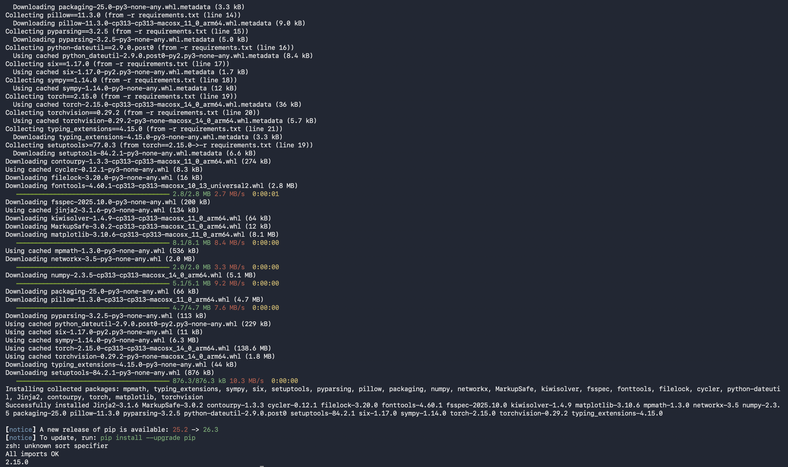

# Generative MNIST GAN

Simple fully connected Generative Adversarial Network for handwritten digit generation on MNIST.

**GitHub Repository:** https://github.com/sandipdey2/generative-mnist

## Project Overview

- **Task:** Generate realistic 28×28 handwritten digit images
- **Model:** Fully connected GAN (Generator + Discriminator)
- **Dataset:** MNIST (60,000 training images)
- **Training:** 40 epochs on Apple MPS (CUDA/MPS/CPU compatible)
- **Final losses:** D Loss 1.4609 | G Loss 1.7989

## How to Run

```bash
git clone https://github.com/sandipdey2/generative-mnist.git
cd generative-mnist
pip install -r requirements.txt
jupyter notebook generative_model.ipynb
```

Run all cells top to bottom. The notebook downloads MNIST automatically on first run.

### Reproducibility verification



Clean 21-line `requirements.txt` (exact pins, no local paths) and successful import test.

## Files

- `generative_model.ipynb` — complete GAN training and generation workflow
- `module_summary.pdf` — analysis report with exact metrics and citations
- `requirements.txt` — environment for reproducibility
- `reproducibility-screenshot.png` — confirmation of clean install

## Notes

Educational demonstration only. Generated images show recognizable digits but remain blurry with residual mode collapse after 40 epochs, consistent with a basic fully connected architecture.
